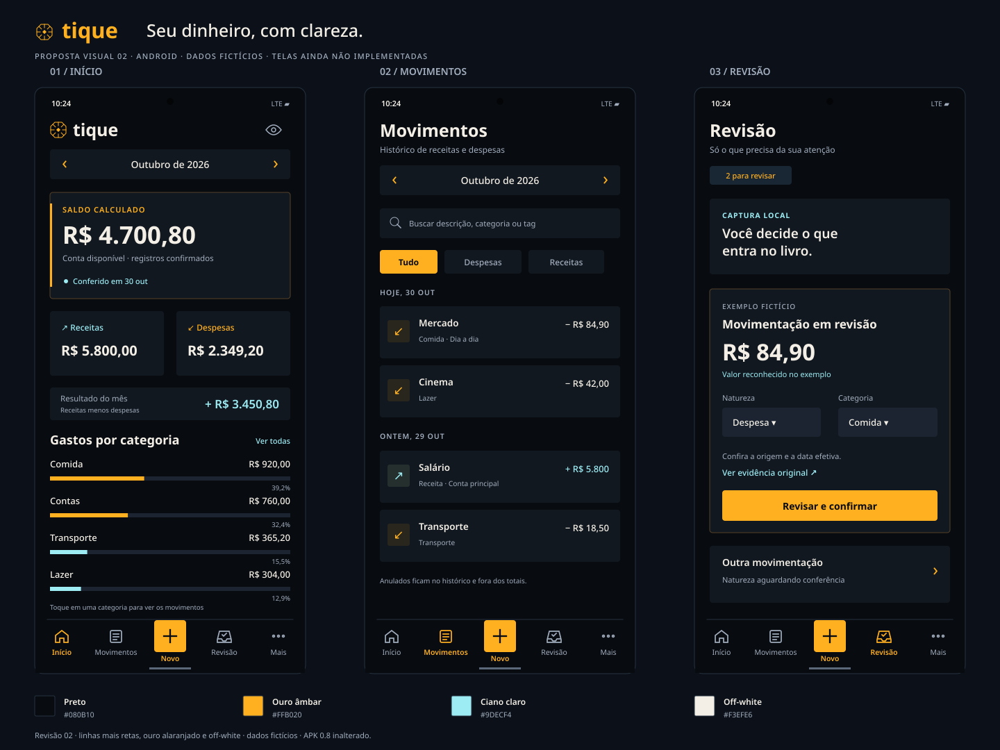

# Tique — interface e uso diário

## Direção atual — duas abas, revisão em lote

Em 31/10/2026, o usuário pediu implementar a primeira entrega do [prompt de uso diário](../prompt-sol-uso-diario.md). Movimentos passa a ser a abertura e divide a navegação com Análises. Fontes migra para **Dados e captura** na engrenagem; importação e compartilhamento continuam acessíveis, sem exigir extrato ou saldo para começar. As pendências são identificadas e permanecem fora dos totais. Revisão em lote exige seleção e natureza explícitas; os meses dos registros confirmados podem ser abertos nas análises. A lista oferece Todos, A revisar e A classificar. Preservar contexto entre abas e detalhes respeitando o bloqueio de informações ao ir para segundo plano.

A direção visual aprovada permanece: preto, âmbar alaranjado, ciano e off-white; cantos pequenos, ações compactas, controles acessíveis. Comparações adicionais, regras reutilizáveis e edição dos metadados de confirmados permanecem no backlog. A implementação e suas verificações são registradas nas notas da release, sem presumir teste no celular.

## Histórico — registro de movimentações e três telas

Em 30/10/2026, o usuário pediu usar o aplicativo por alguns dias e anotar suas percepções, sem novos roteiros específicos de teste. Pediu três telas, navegação simples, pouco texto e prioridade para ícones. Esclareceu que quer **registrar a movimentação do dinheiro**, sem reproduzir exatamente seu dinheiro ou exigir que o saldo calculado coincida com o banco. Este recorte foi autorizado para implementação na 0.10.0; não constitui aprovação física da 0.9.0. O usuário reforçou que extratos são opcionais e quer compartilhá-los para o Tique.

Manter preto, âmbar alaranjado, ciano e off-white, com formas retas. O livro interno e os dados existentes continuam preservados. A abertura e a conferência bancária deixam de ser a tarefa central da interface; a experiência proposta não exige informar patrimônio, saldo inicial real ou ajustar diferenças para começar a registrar. Importações ainda devem respeitar datas e regras do livro; implementar esse começo simples requer resolver essas restrições no serviço, sem forjar saldos nem descartar o histórico.

### Três destinos principais

| Tela | Tarefa e conteúdo |
| --- | --- |
| **Fontes** | Primeira abertura: **Importar extrato**, **Ativar notificações** e opção de começar manualmente. Depois: estado da captura, pausar/retomar, última observação recebida e histórico de importações. Importação é opcional e oferece prévia, origem, registros novos, já vinculados e ambíguos. |
| **Movimentos** | Tela habitual após o início. Lista por dia, busca/filtros, categoria com ícone e origem do registro. Pendências de notificações aparecem nesta mesma tela, identificadas e separadas dos confirmados. Botão **+** abre formulário compacto de entrada/saída; categoria e tags acessíveis pela própria revisão. Detalhes exibem a evidência de origem sob demanda, sem expor payload técnico na lista. |
| **Análises** | Entradas, despesas e resultado **dos registros** do período, categorias e evolução dos gastos. Tocar em gráfico abre Movimentos com o filtro aplicado. Informar período e quantidade de pendências, sem afirmar que notificações representam o extrato completo ou que o resultado seja saldo disponível. |

São três abas estáveis com ícone e rótulo curto. Formulários, detalhes, filtros, categorias e configurações abrem em painéis/modal, preservando o contexto. Engrenagem no cabeçalho reúne backup, recuperação, categorias/tags e privacidade; ferramentas técnicas ficam em seção avançada. Primeira abertura vai a Fontes; uso habitual vai a Movimentos. Fonte/importação não bloqueia lançamento manual.

### Práticas de IHC e uso

- Uma ação principal por contexto; controles frequentes ao alcance do polegar. **+** disponível em Movimentos. Fechar um painel ou voltar preserva período, busca e posição quando aplicável.
- Ícones reconhecíveis com área de toque mínima de 48 dp, nome acessível e rótulo visível quando o significado não for inequívoco. Navegação mantém seus três nomes; não depender de cor, gesto oculto ou ícone abstrato para ações importantes. Respeitar TalkBack e ampliação de fontes. [Orientação Android](https://support.google.com/accessibility/android/answer/7101858?hl=pt-BR).
- Texto curto no fluxo; ajuda contextual e detalhes sob demanda. Consentimento, retenção, risco de perda de backup e confirmação destrutiva continuam claros. Estados vazios oferecem uma ação concreta; falhas informam o problema e como retomar.
- Pendentes não entram nos totais. Uma notificação pode originar candidato, nunca ganhar aparência de transação confirmada antes da decisão. Categoria incerta pode ficar **A classificar**; valor/natureza incertos exigem revisão.
- Registrar manualmente o que faltou; revisar pendências quando conveniente. Não exigir rotina de conferência de saldo, renovação diária de diagnóstico ou execução manual da bateria de desenvolvimento.
- Correção/retirada de um registro deve ter ação simples e manter auditoria. Evitar duplo registro da mesma movimentação por notificação e extrato; valores iguais não são prova de duplicidade. Não usar uma opção genérica de exclusão dos gráficos para disfarçar tipos financeiros ainda sem suporte.
- Entradas e saídas de dinheiro têm significado distinto de receita e despesa: transferência própria, aporte/resgate e pagamento de fatura não devem distorcer os relatórios, mesmo sem tentar reproduzir saldos bancários.
- Recuperação local automática permanece padrão. Backup portátil com senha fica nas configurações, com a diferença sobre desinstalação explicada no contexto. Registros financeiros não são logs de desenvolvimento nem arquivos em claro.

### Captura e extrato: comportamento real, não promessa visual

O `NotificationListenerService` recebe eventos de notificação; ele não dá acesso aos extratos ou telas do Nubank. Dentro dos requisitos locais, sem credenciais nem scraping, oferecer **Ativar notificações** e **Importar extrato**, sem um botão de conexão que prometa obter o histórico. **Abrir Nubank** pode ajudar o usuário a exportar por conta própria, após verificar o app instalado, sem automatizar sua interface. O [Nubank documenta solicitar o extrato no próprio app e recebê-lo por e-mail](https://blog.nubank.com.br/extrato-bancario/); o formato aceito pelo Tique precisa ser validado, sem impor transformação manual do arquivo.

A captura disponível na 0.9.0 ainda é diagnóstica: sessão de 24 horas, limite de 200 observações e retenção de sete dias. Para a proposta de uso diário será necessário um fluxo próprio, com consentimento explícito, pausa/revogação, estado visível, armazenamento cifrado durável e retomada independente do JavaScript. Não renovar silenciosamente o consentimento diagnóstico nem somente esconder seus controles. Definir a retenção do bruto e a preservação dos candidatos/registros antes de habilitar esse fluxo; pendência não pode sumir silenciosamente ao expirar uma amostra. O histórico financeiro confirmado continua independente do bruto. Automação de lançamentos segue dependente de evidências e parsers validados; não declarar suporte Nubank completo por ter acesso às notificações.

As verificações automáticas do desenvolvimento continuam. O usuário prefere avaliar a próxima versão em uso normal, sem novo roteiro ou bateria manual obrigatória. Substituir qualquer trava manual por verificações internas adequadas é trabalho de implementação e exige manter a proteção de chave, banco e migrações; não basta remover o bloqueio visual.

### Referências examinadas e recorte das ideias

Foram consultadas páginas oficiais e inspecionadas imagens públicas de interface. As imagens de ajuda/promoção são referências de padrões, não garantia da aparência da versão atual de cada app. Nenhum código, marca, asset ou screenshot de terceiros será incorporado ao aplicativo ou ao repositório.

- **[Organizze — primeiros passos no Android](https://ajuda.organizze.com.br/hc/pt-br/articles/360044787873-Come%C3%A7ando-a-usar-o-Organizze-no-Android):** ação **+** para receita/despesa e início orientado. Adaptar para começar sem cadastro externo nem checklist de contas/saldos. Sua conexão bancária comercial não é proposta de integração para o Tique.
- **[Mobills — gráficos e relatórios](https://mobills.zendesk.com/hc/pt-br/articles/360049912794-Como-analisar-minhas-despesas-receitas-por-Gr%C3%A1ficos-e-Relat%C3%B3rios):** seletor de período, categorias com ícones/valores e gráficos para categoria/evolução. Manter barras comparáveis no tema angular do Tique; evitar sucessivos menus para chegar à análise.
- **[Cashew — guias oficiais](https://cashewapp.web.app/faq.html):** lançamento compacto, estatísticas por período com acesso aos movimentos e metas por categoria. Aproveitar os padrões de interação; não trazer navegação altamente configurável, correções automáticas de saldo ou serviços de sincronização.

Para o próximo recorte, priorizar lista por dia, filtro **A revisar/A classificar**, categoria rápida, procedência discreta e gráficos ligados ao histórico. Evolução diária é uma melhoria pequena para Análises; comparação entre períodos precisa deixar períodos parciais claros. Limites mensais por categoria e reconhecimento de recorrências ficam para depois do uso diário básico. Não acrescentar tudo na mesma entrega nem apresentar controles fictícios para recursos não implementados.

## Referência histórica — revisão visual 02 / APK 0.9.0

Status: **revisão 02 aprovada pelo usuário e implementada na 0.9.0; validação visual no aparelho pendente**. O usuário pediu menos curvas, um amarelo mais intenso puxando para laranja, manutenção do ciano e uso de off-white. A revisão 02 aplica essa direção; o usuário aprovou essa direção e pediu gráficos no app. A validação física do livro 0.8.0 continua pendente e não deve ser considerada aprovada por esta discussão.

O [SVG autoral](tique-interface-proposta-v2.svg) é a fonte editável da imagem. São conceitos de telas Android, sem código de produto, dados bancários, assets ou capturas de concorrentes. Valores, movimentos e estados de conferência da imagem são fictícios.

## Direção visual

Interface escura, moderna e geométrica. O preto predomina; o ouro âmbar intenso marca identidade, ações e seleção; o ciano comunica informações, vínculos e receitas. Os valores e textos principais usam off-white quente. Um símbolo angular próprio, com oito faces e raios retos, acompanha o nome Tique. A marca usa tipografia simples; o desenho definitivo pode ser refinado depois.

| Uso | Cor |
| --- | --- |
| Fundo principal | `#080B10` |
| Cartões | `#121820` |
| Superfície elevada | `#1B2430` |
| Ouro âmbar / amarelo alaranjado | `#FFB020` |
| Ciano claro | `#9DECF4` |
| Texto principal off-white | `#F3EFE6` |
| Texto secundário | `#A2AEBE` |
| Divisórias | `#263240` |

Botões em ouro âmbar usam texto preto e preenchimento sólido. Cartões, campos, filtros e ações passam a retângulos com cantos de cerca de 4 dp; as barras dos gráficos têm extremidades retas. O botão central `+` também é retangular, com raio pequeno, e os ícones seguem traços mais angulares. As superfícies escuras mantêm a separação por contraste e linhas finas. Vermelho/coral pode ser usado funcionalmente para diferença negativa ou erro, sempre acompanhado de texto/ícone. Despesa normal não deve ser apresentada como erro.

Tipografia sem serifa, com números bem legíveis, alinhamento consistente de valores e espaço entre seções. Na implementação, respeitar escala de fonte do Android, área segura e alvos de toque de pelo menos 48 dp. Não depender só de cor para distinguir receita, despesa, seleção ou anulação. A composição apresentada é referência, não um tamanho fixo de tela.

## Navegação principal

Barra inferior com quatro destinos e um botão central de ação:

| Destino | Conteúdo |
| --- | --- |
| **Início** | Mês selecionado, saldo calculado da conta, receitas, despesas, resultado do mês, categorias e acesso aos movimentos recentes. |
| **Movimentos** | Histórico, busca, filtros por natureza/categoria/tag, detalhes e anulação de registro. |
| **+ Novo** | Painel curto para receita ou despesa. Outros tipos aparecem quando houver suporte financeiro correto. |
| **Revisão** | Observações/candidatos pendentes, campos incertos, evidência original e confirmação explícita no livro. |
| **Mais** | Conta, categorias/tags, conferência de saldo, proteção/backup, captura e configurações. |

O botão `+` abre uma ação; não é uma quinta página. Revisão recebe um contador somente quando houver itens pendentes. Categorias, tags, backup e testes não disputam espaço com o dashboard.

Em **Mais**, organizar por tarefas: **Finanças** (conta, categorias/tags, conferir saldo), **Proteção e dados** (backup/recuperação e, quando pronta, importação de extrato) e **Configurações** (captura/permissões, privacidade/aparência e ferramentas avançadas). Diagnóstico, testes e descarte de caixas ficam na área avançada. As cópias automáticas permanecem como padrão; tarefas com arquivos são opcionais.

Contas adicionais, cartões, faturas, caixinhas e planejamento poderão entrar em uma seção Carteira/Planejamento quando esses recursos estiverem implementados. Não apresentar páginas vazias ou controles desabilitados para simular recursos futuros. Busca e filtros na imagem também são propostas de interação, não funcionalidades já entregues no APK atual.

## Composição do dashboard

1. Seletor de mês acessível no topo, com voltar/avançar.
2. Cartão de **saldo calculado da conta disponível**, com controle para ocultar valores e estado real da última conferência. Saldo é atual, enquanto receitas/despesas/resultados se referem ao mês selecionado; os rótulos devem deixar esse recorte claro.
3. Dois cartões compactos para receitas e despesas do mês; resultado aparece separado como receitas menos despesas, sem chamar essa diferença de patrimônio, lucro ou economia garantida.
4. Gastos por categoria em barras horizontais ordenadas, com valor e percentual. Tocar em uma categoria abre os movimentos filtrados. Barras favorecem comparar valores e nomes longos; gráfico de rosca pode ser uma alternativa posterior, sem necessidade nesta primeira interface.
5. Movimentos recentes após as categorias, acessíveis ao rolar. O conceito estático mostra a primeira área visível; não é uma lista completa do conteúdo da tela.

Só usar dados do livro confirmado. Anulados não entram nos totais; transferências e pagamentos de fatura não viram despesas para alimentar gráficos. Meses vazios exibem estado vazio, sem dados inventados ou tendências fictícias. Uma diferença de conferência permanece visível, sem ajustar saldo automaticamente.

Na revisão, o resumo abre o formulário para conferir valor, natureza, categoria, data efetiva e conta. O visual não deve sugerir que o parser reconheceu campos que continuam desconhecidos; “Revisar e confirmar” não elimina as validações financeiras existentes. A captura segue com o consentimento e os limites reais da versão instalada.

## Histórico visual

A [primeira proposta](tique-interface-proposta.png) e seu [SVG](tique-interface-proposta.svg) foram preservados para comparação. A revisão 02 substitui o dourado suave e os cartões arredondados por ouro âmbar mais saturado, off-white e geometria mais reta. O ciano e os destinos de navegação foram mantidos. A 0.9.0 aplica o conceito com gráficos, filtros e navegação; as imagens permanecem como referência conceitual com dados fictícios, não como capturas do APK.

## Referências consultadas

- [Organizze — apresentação oficial](https://www.organizze.com.br/): organização de contas/movimentos e entendimento de gastos por categoria. A referência aqui é a clareza das tarefas financeiras.
- [Wallet — dashboard e cartões](https://support.budgetbakers.com/hc/en-us/articles/7150077480850-Add-or-Modify-Dashboard-Cards-Widgets): organização da visão geral em cartões. Personalização com arrastar cartões fica fora desta proposta inicial.
- [Mobills — gerenciamento de categorias](https://mobills.zendesk.com/hc/pt-br/articles/360051317613-Como-criar-categorias-para-despesas-e-receitas): acesso às categorias pelo menu Mais e distinção entre receitas e despesas.

As referências são conceituais. Não foram reutilizados código, ícones, logos, screenshots ou textos de interface desses aplicativos. Serviços e integrações dos produtos de referência não fazem parte da proposta técnica do Tique.
